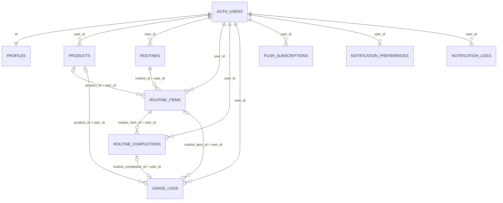

# My Skin Diary database design

## Scope

The schema contains nine application tables. `auth.users` is the existing Supabase Auth identity table and is not an application table. Application records are private to one Auth user. No remote database is linked or changed by this migration.

## ERD

`PROFILES.id` is both its primary key and a cascading foreign key to `auth.users.id`; it therefore has the same ownership boundary as a `user_id` column. Every other personal table stores `user_id` directly. Composite foreign keys include `user_id` so an item, completion, or activity cannot reference another user's product/routine even if a client submits a valid UUID.

## Tables, keys, and PostgreSQL types

| Table | Primary key | Important columns and types | Relationships |
| --- | --- | --- | --- |
| `profiles` | `id UUID` | `display_name TEXT`, `avatar_url TEXT`, `timezone TEXT`, `created_at/updated_at TIMESTAMPTZ` | `id → auth.users.id`, one-to-one; deleted with its Auth user. |
| `products` | `id UUID` | `user_id UUID`, `category TEXT`, `price_amount NUMERIC(12,2)`, `currency_code CHAR(3)`, `skin_types/ingredients TEXT[]`, `expires_on DATE`, `opened_on DATE`, `pao_months SMALLINT`, timestamps | Belongs to one Auth user. Referenced by routine items and usage logs. |
| `routines` | `id UUID` | `user_id UUID`, `kind/name/description TEXT`, `position INTEGER`, `is_active BOOLEAN`, `active_days SMALLINT[]`, timestamps | Belongs to one Auth user; owns ordered routine items. Morning and evening kinds are unique per user; active days are ISO weekdays (Monday=1 through Sunday=7). |
| `routine_items` | `id UUID` | `user_id/routine_id/product_id UUID`, `label/instructions TEXT`, `position INTEGER`, timestamps | Composite FK to its routine and optional product, each constrained to the same user. |
| `routine_completions` | `id UUID` | `user_id/routine_item_id UUID`, `completed_on DATE`, `completed_at/created_at TIMESTAMPTZ` | Belongs to one routine item; one completion per item and calendar date. Removing its item removes its completions. |
| `usage_logs` | `id UUID` | `user_id/product_id/routine_item_id/routine_completion_id UUID`, `activity_type TEXT`, `activity_date DATE`, `occurred_at TIMESTAMPTZ`, `mood/skin_area/notes TEXT`, `tags TEXT[]` | Belongs to one Auth user; optional product/item/completion references are same-user only. A routine completion has at most one linked usage log; removing that completion removes the linked log. |
| `push_subscriptions` | `id UUID` | `user_id UUID`, `endpoint/p256dh_key/auth_secret TEXT`, `expires_at/created_at/updated_at TIMESTAMPTZ` | Belongs to one Auth user; endpoint is unique per user. |
| `notification_preferences` | `user_id UUID` | enable flags `BOOLEAN`, recurring local reminder times `TIME WITHOUT TIME ZONE`, `weekly_summary_iso_day SMALLINT`, `timezone TEXT`, timestamps | One row per Auth user. Wall-clock times are interpreted in the stored timezone. |
| `notification_logs` | `id UUID` | `user_id UUID`, notification/status/dedupe/title/body `TEXT`, `scheduled_at/sent_at/delivered_at/read_at/created_at/updated_at TIMESTAMPTZ`, `metadata JSONB` | Belongs to one Auth user; optional `(user_id, dedupe_key)` is unique. |

UUID primary keys use `gen_random_uuid()`. Timestamps are `TIMESTAMPTZ`; calendar entries and completion dates use `DATE` so a user's local day is not shifted by a timezone conversion. Recurring reminder times use `TIME WITHOUT TIME ZONE` alongside an IANA timezone name.

### Expiry and PAO

`expires_on` is the printed/manufacturer expiry date, `opened_on` is the user's opening date, and `pao_months` is the package's period-after-opening duration. They are independent inputs. There is no persisted `pao_expires_on` field and no frontend value is written back as a calculated expiry. If the UI displays a PAO-derived date, calculate it on demand from these source fields and do not store the result.

## Unique constraints and indexes

- Composite unique keys `(id, user_id)` on products, routines, and routine items support same-owner foreign keys.
- `routine_items(routine_id, position)` prevents two steps occupying the same position in a routine.
- `routine_completions(user_id, routine_item_id, completed_on)` prevents duplicate daily checkmarks.
- `(user_id, routine_completion_id)` prevents duplicate calendar events for the same checklist completion; null IDs remain available for manual notes and other usage entries.
- `push_subscriptions(user_id, endpoint)` prevents duplicate endpoints for one user.
- `notification_preferences.user_id` is its primary key; `(user_id, dedupe_key)` prevents duplicate notification jobs when a dedupe key is supplied.
- User-leading indexes cover product expiry/category/opened dates, routine ordering, item-to-product lookup, completion/activity dates, subscriptions, and notification history/queue. A GIN index supports usage-log tag filtering.

## Row Level Security

RLS is enabled on all nine public tables. For every table, policies are restricted to the `authenticated` database role and independently enforce `SELECT`, `INSERT`, `UPDATE`, and `DELETE` for the row owner (`profiles.id = auth.uid()`; other tables `user_id = auth.uid()`). Updates check both the existing and resulting owner value. The migration revokes `PUBLIC`, `anon`, and existing `authenticated` table grants, then grants CRUD only to `authenticated` and relies on the owner policies to scope those privileges to the current user. Anonymous clients receive neither table grants nor policies.

`service_role` is an administrative server credential and bypasses RLS; never put it in the browser. The profile creation trigger is a narrowly scoped `SECURITY DEFINER` function with an empty search path and an idempotent insert.

## Migration and local verification

`migrations/20261101000000_initial_skin_diary_schema.sql` creates the schema, indexes, timestamp/profile triggers, grants, RLS, and 36 owner policies in one transaction. `migrations/20261102000000_routines_calendar.sql` adds routine active weekdays, a completion-to-usage-log relationship, and authenticated invoker RPCs for idempotent completion toggles and item ordering. The follow-up migration is additive and re-runnable; it does not remove existing user data. It will fail rather than discard duplicate morning/evening routines if those already exist and conflict with the new one-per-kind rule.

`tests/rls_isolation.test.sql` and `tests/routine_calendar.test.sql` are pgTAP checks for isolated test databases. The routine test checks idempotent completion, linked calendar logs, item order changes, and cross-user rejection. For the existing My Skin Diary development project, review and run the two migration SQL files in Supabase Dashboard → SQL Editor first, then verify in the signed-in app:

1. Create morning/evening routines, add products, change active weekdays and reminder times, then reload the app and confirm the database values persist.
2. Reorder steps and verify `routine_items.position` changes.
3. Check a step twice and confirm only one `routine_completions` row and one linked `usage_logs` row exist for that item/date. Confirm its event appears on the same Asia/Jakarta calendar date.
4. Uncheck it and confirm both rows disappear; add a skin note and confirm it appears in `usage_logs` and the calendar agenda.
5. Add a product with `expires_on` and confirm its date has an expiry marker and detail in both calendar views.

The test files are not run against the hosted development project by this frontend build. Keep them for a database test workflow; no local stack or extra environment is needed for the documented SQL Editor and browser verification.
